<!-- ABHAY · The Developer Arc. Every image here is an original SVG drawn for this profile. -->

<a href="https://abhay.stream">
  <picture>
    <source media="(prefers-color-scheme: dark) and (prefers-reduced-motion: reduce)" srcset="assets/hero-dark-static.svg">
    <source media="(prefers-color-scheme: light) and (prefers-reduced-motion: reduce)" srcset="assets/hero-light-static.svg">
    <source media="(prefers-color-scheme: dark)" srcset="assets/hero-dark.svg">
    <source media="(prefers-color-scheme: light)" srcset="assets/hero-light.svg">
    
  </picture>
</a>

  <b>Abhay Upadhyay</b> · Full-stack &amp; GenAI engineer at Pocket FM, building web products, LLM workflows and Go services. 
  <a href="https://abhay.stream"><b>abhay.stream</b></a> · <a href="https://www.linkedin.com/in/abhay-upadhyay-134282324/">LinkedIn</a> · <a href="mailto:abhayupa01@gmail.com">Email</a>

  <picture>
    <source media="(prefers-color-scheme: dark)" srcset="assets/dossier-dark.svg">
    <source media="(prefers-color-scheme: light)" srcset="assets/dossier-light.svg">
    
  </picture>

Dossier as text

| Field | Detail |
| :-- | :-- |
| Class | Full-Stack · GenAI Engineer |
| Guild | Pocket FM, Bengaluru · since January 2026 |
| Focus | LLM workflows · web products · Go services |
| Previous arc | Yugabyte · Software Engineer Intern · 2025 |
| Origin | IIIT Allahabad · B.Tech, Electronics &amp; Communication Engineering · 2022–2026 |
| LeetCode | Peak rating 1944 · [profile](https://leetcode.com/u/unknown_015/) |
| Codeforces | Max rating 1908, Candidate Master · [profile](https://codeforces.com/profile/_hmt) |
| CodeChef | Highest rating 2149, 5★ · [profile](https://www.codechef.com/users/aa333) |

Ratings were read from each public profile in October 2026. Section names (class, guild, arc) are flavour.

  <picture>
    <source media="(prefers-color-scheme: dark)" srcset="assets/arsenal-dark.svg">
    <source media="(prefers-color-scheme: light)" srcset="assets/arsenal-light.svg">
    
  </picture>

Arsenal as text

**Languages** Go · Python · TypeScript · JavaScript &nbsp;·&nbsp; **Frontend** React · Next.js &nbsp;·&nbsp; **Backend** Node.js · Django · FastAPI &nbsp;·&nbsp; **Data and streams** MySQL · Redis · ScyllaDB · Kafka · RabbitMQ · Temporal &nbsp;·&nbsp; **Cloud and DevOps** Docker · Kubernetes · AWS · Git &nbsp;·&nbsp; **AI** Hugging Face · Claude

  <picture>
    <source media="(prefers-color-scheme: dark)" srcset="assets/chapter-03-dark.svg">
    <source media="(prefers-color-scheme: light)" srcset="assets/chapter-03-light.svg">
    
  </picture>

  <a href="https://github.com/abhay07154/Phoenix-grid"><picture><source media="(prefers-color-scheme: dark)" srcset="assets/quest-phoenix-dark.svg"><source media="(prefers-color-scheme: light)" srcset="assets/quest-phoenix-light.svg"></picture></a>
  <a href="https://github.com/abhay07154/AmoCart.ai"><picture><source media="(prefers-color-scheme: dark)" srcset="assets/quest-amocart-dark.svg"><source media="(prefers-color-scheme: light)" srcset="assets/quest-amocart-light.svg"></picture></a>
  <a href="https://github.com/abhay07154/InnoRooms"><picture><source media="(prefers-color-scheme: dark)" srcset="assets/quest-innorooms-dark.svg"><source media="(prefers-color-scheme: light)" srcset="assets/quest-innorooms-light.svg"></picture></a>

Live: <a href="https://windowshop-ai-demo.onrender.com/">AmoCart.ai demo</a> · <a href="https://hotel-booking-web-app.vercel.app/">InnoRooms</a> · free hosting, so the first load can take up to a minute.

  <picture>
    <source media="(prefers-color-scheme: dark)" srcset="assets/chapter-04-dark.svg">
    <source media="(prefers-color-scheme: light)" srcset="assets/chapter-04-light.svg">
    
  </picture>

  <picture>
    <source media="(prefers-color-scheme: dark)" srcset="https://raw.githubusercontent.com/abhay07154/abhay07154/output/snake-dark.svg">
    <source media="(prefers-color-scheme: light)" srcset="https://raw.githubusercontent.com/abhay07154/abhay07154/output/snake-light.svg">
    
  </picture>

  <a href="https://abhay.stream">
    <picture>
      <source media="(prefers-color-scheme: dark)" srcset="assets/cta-dark.svg">
      <source media="(prefers-color-scheme: light)" srcset="assets/cta-light.svg">
      
    </picture>
  </a>

Illustration and panels: original SVG drawn for this profile. Brand marks from <a href="https://simpleicons.org">Simple Icons</a> (CC0); trademarks belong to their owners.

